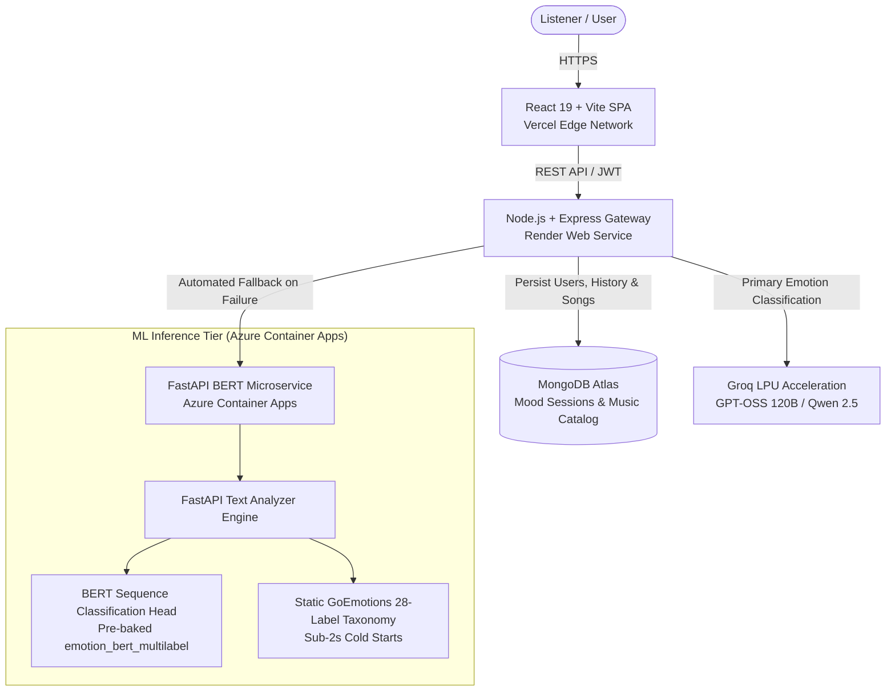

<div align="center">

# Moodify

### AI-Powered Emotion-Adaptive Music Discovery & Recommendation Platform

<p>
  <a href="https://moodify-web-eosin.vercel.app/" target="_blank"></a>
  
  
  
  
  
</p>

<p align="center">
  <b>Moodify</b> is an intelligent, emotion-adaptive music discovery platform. It combines high-speed Groq LPU language model reasoning with a fine-tuned BERT transformer microservice on Azure Container Apps to analyze subjective human thoughts, evaluate nuanced emotional states, and curate dynamically matched soundtrack playlists in real time.
</p>

</div>

---

## Overview

Traditional music recommendation systems rely on static genre tags, popularity algorithms, or rigid mood pickers that fail to capture the subtle complexities of how a listener feels. Moodify fundamentally redesigns music discovery around genuine emotional context:

- **Free-Form Journal & Thought Analysis**: Evaluates natural language expressions, emotional reflections, and stream-of-consciousness journals rather than requiring manual genre selection.
- **Dual-Tier AI Resilience**: Orchestrates primary emotion categorization through low-latency Groq LPU models (`openai/gpt-oss-120b`, `qwen/qwen3.8-27b`) with automated, zero-latency fallback to a containerized BERT multi-label classifier.
- **Categorical Emotion-to-Audio Mapping**: Maps 28 fine-grained GoEmotions psychological states into six curated acoustic mood profiles (`happy`, `sad`, `angry`, `calm`, `energetic`, `neutral`).
- **Interactive Audio Player & Mood Tracking**: Provides integrated in-browser audio streaming, customizable queues, and persistent session journaling stored securely in MongoDB Atlas.
- **Cost-Engineered Serverless Scale-to-Zero**: Engineered for $0.00/mo operating expenditure by leveraging Azure Container Apps serverless consumption profiles (`min-replicas: 0`), lightweight CPU PyTorch binaries, and free-tier cloud orchestration across Vercel, Render, and Azure.

---

## System Architecture

Moodify is built as an event-driven microservices architecture distributed across dedicated cloud platforms for optimal latency and complete cost isolation:



---

## Core Engineering Innovations

### 1. Zero-Credit Burn Serverless Scale-to-Zero on Azure
Hosting heavy machine learning and transformer models typically incurs continuous idle compute charges. Moodify eliminates cloud expenses through a serverless consumption architecture:
- Azure Container Apps is configured on a serverless consumption profile with **`min-replicas: 0`** and **`max-replicas: 2`**.
- When no fallback requests are received, instances scale to zero replicas—drawing **0 vCPU and 0 GiB RAM** ($0.00/hr).
- Because workloads only run during fallback inference, compute operates completely within Azure's permanent monthly free grant (180,000 vCPU-seconds and 360,000 GiB-seconds free every month), preserving 100% of the user's Azure credits.

### 2. Sub-2s Cold Starts via Pre-Baked CPU PyTorch & Local Weights
Transformer microservice cold starts often suffer from multi-minute delays due to gigabyte-sized CUDA dependencies and remote model pulls:
- **Lightweight CPU PyTorch**: The Docker container installs CPU-specific PyTorch wheels (`--extra-index-url https://download.pytorch.org/whl/cpu`), slashing image size by **>1.5 GB** compared to GPU images.
- **Pre-Baked Model Weights**: Model weights (`model.safetensors`, 438MB) are baked directly into the Docker image filesystem, removing runtime download steps.
- **Zero-Network Static Taxonomy**: The 28-label GoEmotions taxonomy is embedded statically into the service, eliminating runtime external Hugging Face Hub queries and preventing `HfUriError` latency or rate limits.
- Enables end-to-end container cold start and inference in **under 2 to 3 seconds**.

### 3. Multi-Tier AI Fault Tolerance & Graceful Fallback
- The API gateway attempts low-temperature emotion classification across a priority queue of Groq LLMs (`openai/gpt-oss-120b`, `qwen/qwen3.8-27b`).
- If Groq encounters rate limiting (HTTP 429), decommissioning, or API downtime, Node's gateway automatically catches the error and redirects the payload to the Azure BERT microservice (`POST /predict`).
- If both external AI layers are unavailable, the gateway falls back safely to a deterministic neutral mood profile, guaranteeing zero 500 error drops for the end user.

---

## Technical Stack

| Tier | Technologies | Responsibility | Hosting Provider |
| :--- | :--- | :--- | :--- |
| **Frontend** | React 19, Vite, Tailwind CSS, Lucide Icons | Responsive music player UI, mood submission, history dashboard, dark theme | Vercel Edge Network |
| **API Gateway** | Node.js, Express, Mongoose, JWT, Axios, CORS | User authentication, mood route orchestration, audio catalog streaming | Render Web Service |
| **Database** | MongoDB Atlas (M0 Shared Tier) | Persistent storage for users, audio catalog, and historical mood sessions | MongoDB Cloud |
| **ML Microservice** | Python 3.10, FastAPI, Uvicorn, PyTorch CPU | Transformer-based emotion prediction, multi-label probability ranking | Azure Container Apps |
| **Transformer Model** | BERT (`emotion_bert_multilabel`) | 28-class GoEmotions fine-tuned multi-label classification head | Pre-baked in Docker |
| **Primary LLM** | Groq LPU (`openai/gpt-oss-120b`, `qwen/qwen3.8-27b`) | Near-instant natural language emotion classification | Groq Cloud |
| **Container Registry** | GitHub Container Registry (`ghcr.io`) | Automated CI/CD container image builds and versioned publishing | GitHub Packages |

---

## API Specifications

### Backend Gateway (Express)

#### `POST /api/mood/detect-text`
Analyzes a natural language journal or thought, detects the dominant emotion, and returns matching songs.

**Request Body:**
```json
{
  "text": "I just received my internship offer! Everything is finally coming together and I couldn't be happier."
}
```

**Response Payload:**
```json
{
  "mood": "happy",
  "modelVersion": "groq_openai/gpt-oss-120b",
  "recommendedSongs": [
    {
      "_id": "6ace4c76410d9b0bf81356bc",
      "title": "Sunshine Road",
      "artist": "Neon Skies",
      "genre": "Pop",
      "mood": "happy",
      "audioUrl": "/songs/happy/happy1.mp3"
    }
  ]
}
```

#### `GET /api/songs/mood/:mood`
Retrieves all curated songs matching a specific mood category (`happy`, `sad`, `angry`, `calm`, `energetic`, `neutral`).

#### `GET /api/mood/history`
Returns historical mood entries and timestamped song recommendations for the authenticated user.

---

### ML Microservice (FastAPI on Azure)

#### `POST /predict`
Performs BERT multi-label probability classification over the submitted text.

**Request Body:**
```json
{
  "text": "I feel completely exhausted and overwhelmed by the past week."
}
```

**Response Payload:**
```json
{
  "emotion": "sad"
}
```

#### `GET /health`
Liveness and readiness probe for Azure Container Apps infrastructure.

**Response:**
```json
{
  "status": "healthy",
  "service": "moodify-ml",
  "device": "cpu"
}
```

---

## Environment Configuration

### Frontend (`frontend/.env`)
```env
VITE_API_BASE_URL=https://moodify-mesk.onrender.com/api
```

### Backend (`backend/.env`)
```env
PORT=5000
MONGO_URI=mongodb+srv://<username>:<password>@cluster0.mongodb.net/moodify?retryWrites=true&w=majority
JWT_SECRET=your_jwt_secret_key
GROQ_API_KEY=gsk_your_groq_api_key
GROQ_MODEL=openai/gpt-oss-120b
ML_SERVICE_URL=https://moodify-ml.calmsea-bf569f70.malaysiawest.azurecontainerapps.io/predict
```

### ML Microservice (Container Environment Variables)
```env
PORT=8002
HOST=0.0.0.0
MODEL_PATH=/app/public/emotion_bert_multilabel
```

---

## Local Setup & Development

### Prerequisites
- Node.js 18+ and npm
- Python 3.10+
- Git
- MongoDB Atlas cluster (or local MongoDB instance)
- Free Groq Cloud account

### 1. Setup the ML Microservice
```bash
cd ml
python -m venv venv

# Windows
venv\Scripts\activate
# Linux/macOS
source venv/bin/activate

pip install -r requirements.txt --extra-index-url https://download.pytorch.org/whl/cpu
uvicorn text_analyzer:app --reload --port 8002
```

### 2. Setup the Backend API Gateway
```bash
cd ../backend
npm install
# Populate backend/.env with your credentials
npm run dev
```

### 3. Setup the Frontend Web App
```bash
cd ../frontend
npm install
npm run dev
```
The client application will run locally at `http://localhost:5173`.

---

## Multi-Cloud Deployment Guide

### 1. ML Microservice (Azure Container Apps)
The repository contains an automated GitHub Actions pipeline in `.github/workflows/deploy-ml.yml` that builds and publishes a Docker image to GitHub Container Registry (GHCR):
```bash
ghcr.io/amalsumesh/moodify-ml:latest
```
1. Deploy an **Azure Container App** using the Serverless Consumption profile.
2. Under **Container details**, choose **Docker Hub or other registries**, select **Public**, and set image to `ghcr.io/<your-username>/moodify-ml:latest`.
3. In **Ingress**, enable external ingress with target port `8002`.
4. In **Scale and Replicas**, set **Min Replicas = 0** and **Max Replicas = 2** for zero-credit burn.

### 2. Backend Gateway (Render)
1. Create a new **Web Service** on Render connected to your repository.
2. Set **Root Directory** to `backend`.
3. Set **Build Command** to `npm install`.
4. Set **Start Command** to `npm start`.
5. Supply environment variables (`MONGO_URI`, `JWT_SECRET`, `GROQ_API_KEY`, `ML_SERVICE_URL`).

### 3. Frontend Web App (Vercel)
1. Import the repository into Vercel.
2. Set **Root Directory** to `frontend`.
3. Select **Vite** as the Framework Preset.
4. Set `VITE_API_BASE_URL` to your Render backend API URL (`https://<your-render-app>.onrender.com/api`).
5. Deploy.

---

## License

This project is licensed under the MIT License. See the [LICENSE](LICENSE) file for full details.
